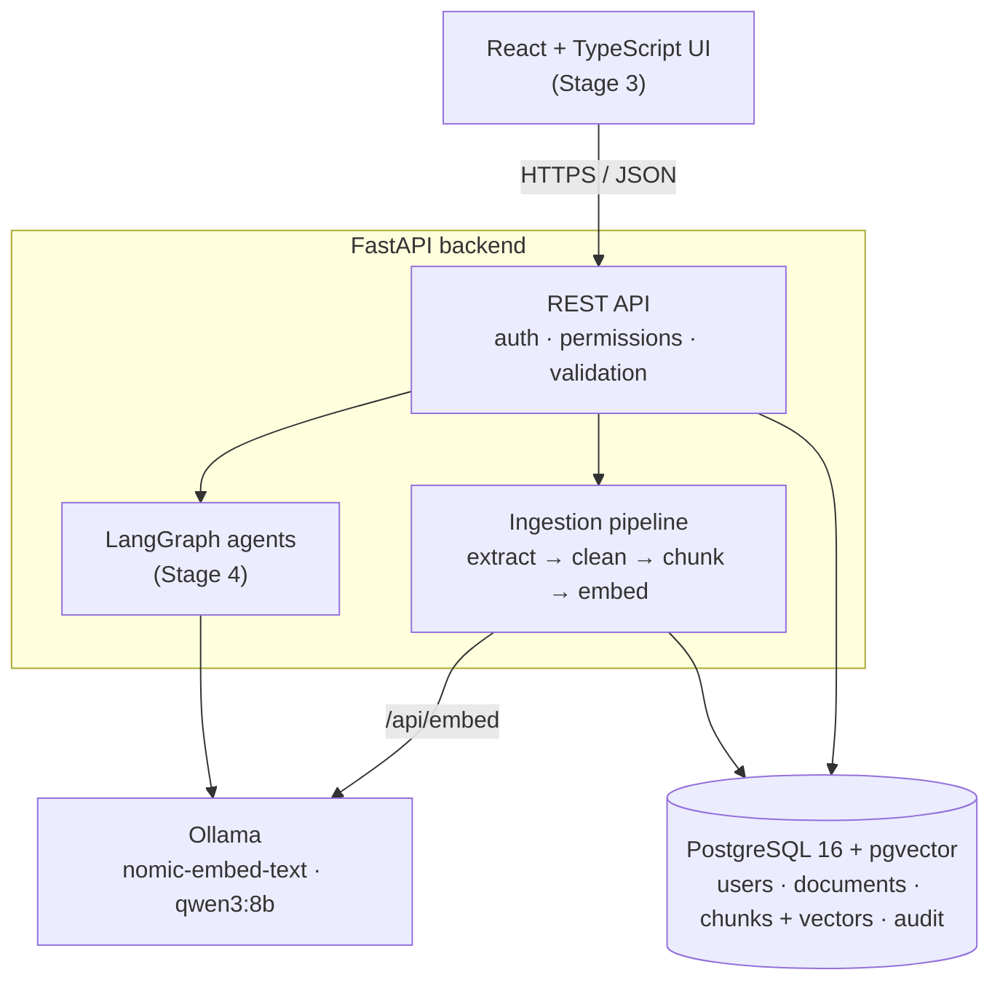

# Enterprise AI Knowledge Assistant

A private, fully local AI assistant that answers questions from a company's own documents, with citations you can check.

Employees upload PDFs, Word files and text files into the collections they belong to. The system extracts the text, splits it into sections, turns each section into an embedding (a vector of numbers that captures its meaning), and stores everything in PostgreSQL. Questions are answered by retrieving the most relevant passages and letting a local LLM write an answer **only from that evidence**, citing every source. If the documents don't contain the answer, it says so.

Everything runs on a single Windows laptop with free, open-source tools. No paid APIs, no cloud services, and no document ever leaves the machine.

> **Project status:** Stages 1–2 of 4 complete (setup and document ingestion). Stage 3 (cited answers, chat UI and evaluation) is next. See the [Roadmap](#roadmap).

---

## Contents

- [Why this project](#why-this-project)
- [Features](#features)
- [Architecture](#architecture)
- [How document ingestion works](#how-document-ingestion-works)
- [Security](#security)
- [Tech stack](#tech-stack)
- [API](#api)
- [Getting started](#getting-started)
- [Running the tests](#running-the-tests)
- [Project structure](#project-structure)
- [Design decisions](#design-decisions)
- [Roadmap](#roadmap)
- [Limitations](#limitations)

---

## Why this project

Most "chat with your PDF" demos stop at uploading a file and asking a question. Real organisations need more than that:

| A plain chatbot… | This assistant… |
|---|---|
| answers from general training data and may invent procedures | answers **only from retrieved company documents** |
| gives no way to check an answer | **cites the document, page and section** for every statement *(Stage 3)* |
| shows every document to everyone | **filters by permissions before retrieval**; users only ever see their own collections |
| treats uploaded text as trusted | treats documents as **untrusted input** (file validation, prompt-injection defences) |
| "seems to work" | is **measured** with a benchmark of test questions *(Stage 3)* |

The guiding idea: **an AI system is only as useful as it is verifiable.**

---

## Features

### Built (Stages 1–2)

- **Login with hashed passwords.** Argon2 password hashing and signed JWT tokens that expire after 60 minutes. Every login attempt, successful or not, is recorded.
- **Collection-based permissions.** Documents belong to collections (e.g. *Engineering*, *Finance*). Users see only collections they're members of; admins see everything. Asking for someone else's document returns `404`, which blocks IDOR attacks.
- **Safe uploads (PDF, DOCX, TXT).**
  - The real file type is detected from the file's content, so a renamed `.exe` is rejected.
  - Uploads are limited to 20 MB, and Word "zip bombs" are blocked.
  - Duplicate uploads are detected by SHA-256 checksum.
  - Files are stored under random names, so a user-supplied filename can never write outside the upload folder.
- **Background ingestion pipeline.** Extract → clean → chunk → embed → store, with a visible status (`queued → extracting → embedding → ready / failed`) and a readable error message when something fails.
- **Structure-aware chunking.** Chunks follow headings and never cross a page boundary, so every chunk knows its exact page and section for citations.
- **Reliability.** Embedding calls retry with backoff. Chunks and the "ready" status are saved in one transaction. Re-processing never creates duplicates. Unfinished documents restart automatically when the server restarts.
- **Audit log.** Logins, uploads, deletions and admin actions are recorded with the user, time and IP address.
- **Database migrations** with Alembic, plus **17 automated tests**, including security tests.

### Planned

- **Stage 3:** cited answers, "insufficient evidence" refusals, a streaming React chat UI, a benchmark of 50–100 questions, and retrieval metrics (recall@k, groundedness, abstention).
- **Stage 4:** LangGraph multi-agent workflows (research → analysis → verification → report) with saved progress, retry limits and human approval.

---

## Architecture



**Retrieval-Augmented Generation (RAG)** separates *finding* information from *writing* it. Vector search finds the passages closest in meaning to the question, and the LLM writes an answer from those passages only. Updating knowledge means re-indexing a document, not retraining a model, and every statement can be traced to its source.

---

## How document ingestion works

```
upload ─▶ validate ─▶ store file ─▶ 202 Accepted
                                        │  (background job)
                                        ▼
                 queued ─▶ extracting ─▶ embedding ─▶ ready
                    └──────────┴─────────────┴──────▶ failed (+ reason)
```

| Step | What happens |
|---|---|
| **Extract** | **PDF:** text page by page with page numbers. **DOCX:** paragraphs and tables in document order; "Heading" styles become section titles. **TXT:** read as UTF-8. Numbered lines such as `4. API security` are recognised as headings in every format. |
| **Clean** | Removes lines repeated on most PDF pages (headers and footers) and page numbers, re-joins words hyphenated across lines, and normalises whitespace. |
| **Chunk** | Up to ~750 tokens (3,000 characters) per chunk, split at paragraph and sentence boundaries, with ~100 tokens of overlap. A new heading or page always starts a new chunk, and the heading is kept at the top of the chunk for context. |
| **Embed** | Sends batches of 16 chunks to Ollama's `nomic-embed-text` (768 dimensions), using the model's `search_document:` task prefix. Failed calls are retried up to 3 times with exponential backoff, and the output is validated. |
| **Store** | Replaces any old chunks, then saves the new chunks and the `ready` status in a single transaction. |

Example: the 3-page sample PDF produces 9 chunks, each tagged with its page and section (`p.2 · "4. API security"`).

---

## Security

| Threat | Defence |
|---|---|
| Stolen password database | Only Argon2 hashes are stored |
| Discovering valid emails | The same error message and the same response time for an unknown email or a wrong password |
| Reading someone else's document by changing the ID (IDOR) | Every request checks collection membership in one central function; forbidden documents return `404` |
| Malicious uploads | The type is detected from file content, plus size and unpacked-size limits, random storage names and path-traversal-safe display names |
| Secrets in Git | `.env` is git-ignored, and `.env.example` documents the settings without values |
| Leaking internal fields | Response schemas list the exact fields returned, so `password_hash` and `storage_path` never appear |
| LLM deciding access | Permissions are enforced in code before retrieval; the model never decides what a user may see |
| Prompt injection via documents *(Stage 3)* | Evidence is delimited as data, the LLM has no privileged tools, answers are verified against sources, and injection test cases are in the benchmark |

---

## Tech stack

| Layer | Technology |
|---|---|
| LLM runtime | [Ollama](https://ollama.com), local, CPU-only |
| Models | `qwen3:8b` (answers, 4-bit quantised) · `nomic-embed-text` (embeddings, 768-dim) |
| Backend | Python 3.14 · FastAPI · Pydantic · Uvicorn |
| Database | PostgreSQL 16 · [pgvector](https://github.com/pgvector/pgvector) 0.8.7 · SQLAlchemy 2.0 · Alembic |
| Auth | Argon2 (`pwdlib`) · JWT (`PyJWT`) |
| Documents | `pypdf` · `python-docx` |
| Agents *(Stage 4)* | LangGraph |
| Frontend *(Stage 3)* | React + TypeScript |
| Tests | pytest |

**Hardware it was built on:** Intel i7-13620H, 16 GB RAM, no dedicated GPU, Windows 11. Models, database and code all live on an external drive. These limits drove the choices of small quantised models, a compact top-k, and streaming answers.

---

## API

Interactive documentation is generated automatically at **`http://localhost:8000/docs`**.

| Method | Endpoint | Purpose | Access |
|---|---|---|---|
| `POST` | `/api/auth/login` | Log in (form fields `username` = email, `password`) → bearer token | Public |
| `GET` | `/api/auth/me` | Current user | Logged in |
| `GET` | `/api/collections` | Collections you can use | Logged in |
| `POST` | `/api/documents` | Upload a file (`collection_id` + `file`) → `202`, processed in the background | Collection members |
| `GET` | `/api/documents` | List your documents (optional `?collection_id=`) | Logged in |
| `GET` | `/api/documents/{id}` | Status, error, pages, chunk count | Collection members |
| `DELETE` | `/api/documents/{id}` | Delete a document, its chunks and its file | Uploader or admin |
| `GET` | `/api/health` | Database and Ollama status | Public |

---

## Getting started

### Prerequisites

- **Python** 3.12+ (developed on 3.14)
- **PostgreSQL 16** with the **pgvector** extension. On Windows, pgvector is compiled from source with Visual Studio C++ Build Tools; see the [pgvector Windows instructions](https://github.com/pgvector/pgvector#windows).
- **Ollama**, with these two models:
  ```bash
  ollama pull nomic-embed-text
  ollama pull qwen3:8b
  ```

### 1. Install

```bash
git clone https://github.com/Jathin4/enterprise-knowledge-assistant.git
cd enterprise-knowledge-assistant
python -m venv .venv
.venv\Scripts\activate          # macOS/Linux: source .venv/bin/activate
pip install -r requirements.txt
```

### 2. Configure

```bash
copy .env.example .env          # macOS/Linux: cp .env.example .env
```

Edit `.env`: set your PostgreSQL password in `DATABASE_URL`, and generate a `SECRET_KEY`:

```bash
python -c "import secrets; print(secrets.token_hex(32))"
```

### 3. Create the database

```sql
-- in psql
CREATE DATABASE knowledge_assistant;
```

```bash
cd backend
alembic upgrade head            # creates all tables and enables the vector extension
```

### 4. Create users and collections

There is no public sign-up. An admin creates accounts:

```bash
python manage.py create-collection Engineering
python manage.py create-user alice@example.com --role employee     # prompts for a password (12+ characters)
python manage.py add-member alice@example.com Engineering
python manage.py create-user admin@example.com --role admin
python manage.py list
```

### 5. Run

```bash
uvicorn app.main:app --reload --port 8000
```

Open <http://localhost:8000/docs>, click **Authorize**, and log in with an email (as *username*) and password. Then upload a file with `POST /api/documents` and watch its status with `GET /api/documents/{id}`.

### Sample documents

`sample-docs/` contains synthetic documents for a fictional company, *Brightline Analytics*, generated by `sample-docs/make_samples.py`:

| File | Exercises |
|---|---|
| `api_authentication_guide.docx` | Word headings (2 levels) and a table |
| `information_security_policy.pdf` | 3 pages with repeated headers and "Page N of 3" footers |
| `expense_policy.txt` | Plain text with numbered sections |

---

## Running the tests

```bash
cd backend
pytest -q
```

The tests use a separate database, `knowledge_assistant_test`, which is created automatically, and replace Ollama with fake embeddings, so they are fast and never touch real data.

| File | Covers |
|---|---|
| `tests/test_ingestion.py` | File-type detection (renamed executables rejected), header/footer removal, heading detection, sentence-aware splitting, chunk size and overlap, page and heading boundaries, status rules |
| `tests/test_documents.py` | Login required; all three formats reach `ready`; 400/409/413/415 validation errors; **users can't see, open or delete other collections' documents**; delete removes chunks and files; an Ollama failure marks the document `failed` without saving partial chunks; a scanned PDF gives a clear error |

```
17 passed in 7.9s
```

---

## Project structure

```
enterprise-knowledge-assistant/
├── backend/
│   ├── app/
│   │   ├── main.py          # FastAPI app, health check, resumes unfinished jobs on start
│   │   ├── config.py        # typed settings from .env
│   │   ├── db.py            # engine, sessions, timezone-aware timestamps
│   │   ├── models.py        # users, collections, members, documents, chunks, audit_events
│   │   ├── schemas.py       # API response shapes
│   │   ├── security.py      # login, JWT, permissions, audit log
│   │   ├── ingestion.py     # validate, extract, clean, chunk, embed, store
│   │   └── routers/
│   │       ├── auth.py      # /api/auth/*
│   │       └── documents.py # /api/collections, /api/documents/*
│   ├── alembic/             # database migrations
│   ├── tests/               # pytest suite
│   ├── manage.py            # admin CLI: users, collections, members
│   ├── alembic.ini
│   └── pytest.ini
├── sample-docs/             # synthetic test documents + generator script
├── hello_rag.py             # Stage 1 proof of concept: the whole RAG loop in ~70 lines
├── requirements.txt
└── .env.example
```

---

## Design decisions

| Decision | Choice | Why |
|---|---|---|
| Vector store | pgvector inside PostgreSQL | One database for users, permissions and vectors, so permission filters and similarity search run in the same SQL query |
| Search | Exact search first, HNSW index later | Exact search is always correct and fast enough at this size. An index is added only when measurements show it's needed |
| Permissions | Collections with members | Simple to reason about and test. The same function filters API responses now and vector search in Stage 3 |
| Chunk size | ~750 tokens, ~100 overlap, split on headings and pages | Inside the common 500–800 range, keeps citations exact, and will be tuned with benchmark data in Stage 3 |
| Background jobs | FastAPI background tasks plus resume on startup | No extra infrastructure (Redis or Celery) for a single-machine app |
| Users | Created with an admin CLI | A company assistant shouldn't allow public sign-up |
| Models | Small, quantised, local | Runs on CPU in 16 GB RAM, costs nothing, and keeps data private |
| Embedding prefixes | `search_document:` / `search_query:` | `nomic-embed-text` is trained with these task prefixes |

---

## Roadmap

| Stage | Weeks | Scope | Status |
|---|---|---|---|
| 1 · Setup | 1–2 | Local Ollama, PostgreSQL + pgvector, "hello RAG" proof of concept | ✅ Done |
| 2 · Ingestion | 3–4 | Backend, auth, permissions, upload, extract/chunk/embed pipeline, tests | ✅ Done |
| 3 · RAG and evaluation | 5–6 | Cited answers, abstention, streaming chat UI (React), 50–100 question benchmark, recall@k, groundedness, chunk-size experiments | ⏭️ Next |
| 4 · Agents | 7–8 | LangGraph research → analysis → verification → report, checkpoints, bounded retries, human approval, live progress | ⬜ Planned |
| Polish | 15–16 | Security review, failure handling, screenshots, demo video | ⬜ Planned |

---

## Limitations

- **CPU-only inference.** Answers take tens of seconds on a laptop without a GPU, which is why they will be streamed.
- **No OCR yet.** Scanned PDFs without a text layer fail with a clear message instead of being processed.
- **Single machine.** This isn't built for many concurrent users.
- **No document versioning, rate limiting on login, or refresh tokens yet.** They're on the polish list.
- **Synthetic sample data.** The sample documents and later benchmark results describe a fictional company, not real-world performance.

---

*Learning and portfolio project. All sample documents describe a fictional company.*
